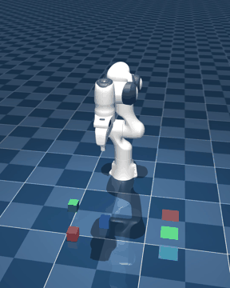
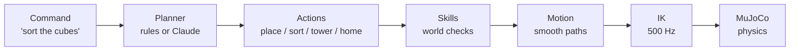

# SortBot

**A simulated robot arm that sorts and stacks cubes from plain English commands.**

Type `sort the cubes by color` or `build a tower: blue, green, red on top` and a Franka Panda arm
plans the moves, solves its own inverse kinematics 500 times per second, and does it in a
physics simulation. Pure Python, runs on any laptop, no robot or GPU needed.



## What's inside

| Piece | What it does | File |
| --- | --- | --- |
| Physics | MuJoCo simulates the arm, gripper, cubes, contacts and friction | `robot/scene.xml` |
| Forward kinematics | Joint angles to gripper position, verified against MuJoCo | `lessons/02_forward_kinematics.py` |
| Inverse kinematics | Damped least squares on the Jacobian, with null-space posture control | `sortbot/ik.py` |
| Motion | Minimum-jerk trajectories with velocity feedforward (about 4 mm average tracking error) | `sortbot/motion.py` |
| Skills | Pick, place, sort, stack, with checks (clears blocked cubes and occupied pads first) | `sortbot/tasks.py` |
| Language | Keyword parser, or Claude as an LLM planner through a validated tool call | `sortbot/language.py` |



## Quick start

Needs Python 3.10 or newer (3.11+ recommended).

```bash
git clone https://github.com/RohanAdithyaGarlapati/sortbot.git
cd sortbot
python -m venv .venv
source .venv/bin/activate            # Windows: .venv\Scripts\activate
pip install -e .

python lessons/05_talk_to_robot.py   # type commands; saves videos/05_talk_to_robot.mp4
```

Add `--view` to any lesson to watch live in a 3D window instead of recording a video.
On macOS the live window needs `mjpython` instead of `python`, for example
`mjpython lessons/04_pick_and_place.py --view`.

## The five lessons

Each lesson is one short, commented file that builds on the previous one.

| # | Lesson | You learn |
| --- | --- | --- |
| 1 | `01_hello_robot.py` | Models, joints, motors, the simulation loop |
| 2 | `02_forward_kinematics.py` | Transform chains; your numpy FK matches MuJoCo to within 1e-15 m |
| 3 | `03_inverse_kinematics.py` | Jacobians, damped least squares (it's ridge regression), feedforward |
| 4 | `04_pick_and_place.py` | Grasping, smooth trajectories, a pick-and-place state machine |
| 5 | `05_talk_to_robot.py` | Natural language to validated robot actions, optional LLM planner |

## Commands the keyword parser understands

```text
sort the cubes by color
put the red cube on the blue pad
stack green on red, then go home
build a tower: blue, green, red          (listed bottom to top)
make a tower with red at the bottom
red on the blue pad and blue on the red pad
```

Say "pad" or "cube" to be explicit. Towers always use all three cubes.

### Optional: let Claude plan

```bash
pip install -e ".[claude]"
export ANTHROPIC_API_KEY=...             # Windows PowerShell: $env:ANTHROPIC_API_KEY="..."
python lessons/05_talk_to_robot.py --claude
```

Now free-form requests like `swap the red and blue cubes` or `undo the tower` work. Claude only
returns a plan through a forced tool call; every step is validated before the robot moves, so the
LLM can never ask for a motion the robot does not know how to do safely.

## Make your own demo video

```bash
python demo.py --end-card "github.com/RohanAdithyaGarlapati/sortbot" --gif docs/demo.gif
```

Writes a portrait 1080 x 1350 MP4 with typed commands and captions to `videos/sortbot_demo.mp4`
(`--format square` for 1:1), plus a short GIF for this README.

## Tests

```bash
pip install -e ".[dev]"
python -m pytest
```

The physics tests run the full simulation headless: sorting from random layouts, building a
tower, and a swap that needs a temporary parking spot.

## Credits

* [MuJoCo](https://mujoco.org) physics engine by Google DeepMind.
* Franka Emika Panda model from [MuJoCo Menagerie](https://github.com/google-deepmind/mujoco_menagerie)
  (Apache 2.0, see `robot/LICENSE`). SortBot adds a fingertip site and gravity compensation.

SortBot's own code is MIT licensed.

## Author

Built by Rohan Adithya Garlapati.
[LinkedIn](https://www.linkedin.com/in/rohan-adithya-garlapati-05b742264)
